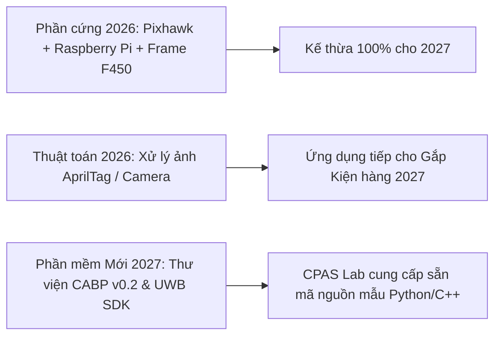

# BÁO CÁO SO SÁNH KỸ THUẬT: UAV CONTEST 2026 VS. KHUÔN MẪU DỰ KIẾN 2027
> **Chủ đề**: *"Phân tích đối sánh kỹ thuật giữa Cuộc thi UAV Contest 2026 (Firefighting & Rescue) và Đề xuất Cuộc thi UAV Contest 2027 (Autonomous Intralogistics & CPAS Swarm)"*  
> **Đơn vị thực hiện**: CPAS Lab, Khoa Điện – Điện tử, Trường Đại học Tôn Đức Thắng (TDTU)  
> **Mục tiêu**: Xây dựng bước chuyển tiếp kỹ thuật "Không lặp lại chủ đề cũ — Đủ Innovation & Trending — Đảm bảo tính khả thi cho sinh viên — Khởi tạo nền tảng CPAS Lab".

---

## 1. TỔNG QUAN SỰ TIẾN HÓA KỸ THUẬT (EVOLUTION SUMMARY)

Năm 2026, cuộc thi tập trung vào bài toán **Chữa cháy & Cứu hộ cứu nạn (Firefighting & Rescue)** với mô hình bay đơn (Single-UAV) kết hợp giữa điều khiển bằng tay (Hiệp 1: Cứu nạn khối xốp $300\text{g}$) và bay tự động theo tọa độ cố định/động (Hiệp 2: Thả bóng tennis vào vòng tròn màu).

Năm 2027, nhân kỷ niệm **30 năm thành lập TDTU (1997–24/9/2027)**, cuộc thi nâng cấp lên bài toán **Logistics Tự chủ & Tác thể Thực-Ảo (Autonomous Intralogistics & Cyber-Physical Swarm Challenge)**:
- **Tận dụng quy mô Nhà thi đấu TDTU Tân Phong ($>1000\text{ m}^2$)**: Triển khai **02 Sân thi đấu song song (kích thước $25\text{ m} \times 30\text{ m}$ / sân)**, giúp nâng gấp đôi công suất thi đấu vòng bảng so với quy mô sân đơn $12\text{ m} \times 35\text{ m}$ tại HCM-UTE năm 2026.
- **Kế thừa & Nâng cấp**: Tận dụng mặt bằng R&D $300\text{ m}^2$ sẵn có tại Cơ sở 98 Ngô Tất Tố để thử nghiệm sa bàn di động, bảo lưu các thuật toán xử lý ảnh AprilTag/Marker từ năm 2026.
- **Đột phá (Innovation)**: Chuyển từ "Thả bóng" sang **Gắp/Phân loại Kiện hàng Thông minh**, bổ sung **Định vị UWB RTLS + VIO**, **Phát quảng bá trạng thái & ý định qua giao thức CABP v0.2**, và **Phối hợp Đa tác tử (UAV + AMR)**.

---

## 2. BẢNG SO SÁNH ĐỐI SÁNH KỸ THUẬT CHI TIẾT (SIDE-BY-SIDE TECHNICAL MATRIX)

| Tiêu chí kỹ thuật | UAV Contest 2026 (HCM-UTE - Firefighting & Rescue) | UAV Contest 2027 (TDTU Tân Phong - Autonomous Intralogistics) | Ý nghĩa nâng cấp & Tác động học thuật |
|---|---|---|---|
| **Bối cảnh kịch bản (Scenario)** | Chữa cháy & Cứu nạn nạn nhân (Firefighting & SAR) trong tòa nhà | Kho hàng tự động & Logistics nội bộ (Smart Warehouse Intralogistics) | Đón đầu xu hướng Industry 4.0/5.0 và Tự động hóa nhà máy |
| **Kích thước Sân (Arena)** | 01 Sân đơn tổng thể $12.0 \times 35.0 \text{ m}$ tại HCM-UTE | **02 Sân song song ($25.0 \times 30.0 \text{ m}$ / sân) tại Nhà thi đấu TDTU ($>1000\text{m}^2$)** | Tăng $100\%$ năng lực thi đấu vòng bảng, phục vụ 20-30 đội thi quốc tế |
| **Hiệp 1 (Phase 1)** | **Cứu nạn bằng tay/bán tự động**: Bay qua cổng TZ1-TZ4 gắp khối xốp $300\text{g}$ | **Gắp & Giao hàng tự trị Đơn tác tử**: Bay tự động gắp gói hàng $8\times 8\times 8\text{cm}$ về trạm | Nâng cấp Hiệp 1 từ điều khiển bằng tay (joystick) lên tự trị hoàn toàn |
| **Hiệp 2 (Phase 2)** | **Chữa cháy tự động 01 UAV**: Thả 05 bóng tennis vào các mục tiêu F1-F5 (F2 di động $10\text{cm/s}$) | **Phối hợp Bầy đàn (Multi-Agent Swarm Relay)**: 2-3 UAV + AMR phối hợp gắp và giao hàng | Mở rộng từ điều khiển 01 UAV sang phối hợp đa tác tử phân tán |
| **Cơ cấu Tải (Payload)** | Cơ cấu kẹp khối xốp $300\text{g}$ + Khay chứa/thả 05 bóng tennis | **Cơ cấu kẹp/hút kiện hàng $100\text{g}$ tích hợp AprilTag** | Chuyển từ thả tự do sang Pick-and-Place chính xác |
| **Công nghệ Định vị** | Camera màu / Marker màu F1-F5 (Định vị UWB là tùy chọn bên ngoài) | **UWB RTLS (DW1000) + VIO (Visual-Inertial Odometry) + AprilTag** | Chuẩn hóa hạ tầng định vị GPS-denied đa cảm biến |
| **Giao thức Truyền tin** | MAVLink / Tần số RC $2.4\text{GHz}/5.8\text{GHz}$ (Chưa có chuẩn giao tiếp giữa các UAV) | **CPAS Agent Beacon Protocol (CABP v0.2)**: Broadcast $5\text{ Hz}$ qua Wi-Fi/UDP | **Đột phá cốt lõi**: Khai phá giao thức chia sẻ trạng thái & ý định ngang hàng |
| **Trạm Đích (Targets)** | Vòng tròn màu trên sàn (D=1.0m, 0.6m, 0.4m) + Mục tiêu F2 trượt $10\text{cm/s}$ | **Trạm kệ hàng A/B/C + Xe tự hành mặt đất (Ground AMR)** | Tích hợp tác thể dị nguyên (Không gian + Mặt đất) |
| **Giám sát Trọng tài** | Cảm biến mục tiêu F1-F5 + Quan sát thủ công của Trọng tài | **Hệ thống Ground Truth Camera System (BOC Logger)** | Đánh giá sai số tự báo cáo của đội thi so với thực tế |
| **Trọng lượng & Kích thước** | Khung $\le 1.0 \times 1.0 \times 1.0\text{m}$, MTOW $\le 5.0\text{kg}$ | **Khung $\le 1.0 \times 1.0 \times 1.0\text{m}$, MTOW $\le 3.5\text{kg}$** | Tối ưu hóa trọng lượng để tăng tính an toàn khi bay bầy đàn |

---

## 3. PHÂN TÍCH TÍNH KHẢ THI CHO SINH VIÊN (STUDENT FEASIBILITY ANALYSIS)

Một lo ngại lớn khi đổi mới luật thi là **khiến sinh viên "khớp" hoặc không kịp thích nghi**. Bộ luật 2027 được thiết kế để giải quyết triệt để rào cản này:

1. **Về Phần cứng**: Sinh viên tận dụng lại $100\%$ phần cứng từ năm 2026 (Khung F450/Quadcopter, Flight Controller Pixhawk/PX4, Companion Computer Raspberry Pi/Jetson Nano, Tay điều khiển RC).
2. **Về Thị giác Máy tính (Computer Vision)**: Năm 2026 sinh viên đã quen với xử lý ảnh nhận diện mục tiêu. Năm 2027 chỉ chuyển từ nhận diện vòng tròn màu sang đọc mã **AprilTag** (vốn đã có sẵn thư viện mã nguồn mở `apriltag` cực kỳ phổ biến).
3. **Về Lập trình Giao thức & Định vị**: Sự phức tạp của giao thức CABP v0.2 và định vị UWB được giải quyết bằng việc **CPAS Lab cung cấp sẵn bộ thư viện mã nguồn mở `cpas_beacon` (Python & C++)**. Sinh viên chỉ cần gọi các hàm API đơn giản như `beacon.get_neighbor_states()` hoặc `beacon.send_intent()`.

---

## 4. TÁC ĐỘNG CHIẾN LƯỢC VỚI CPAS LAB VÀ HỒ SƠ XIN ĐẦU TƯ

Cuộc thi 2026 đóng vai trò là một giải đấu phong trào robotics. Trong khi đó, **UAV Contest 2027** được thiết kế như một **Nền tảng Thực nghiệm Học thuật (Academic Testbed)**:

1. **Khẳng định Vị thế Tiên phong của TDTU**: TDTU không chỉ đăng cai tổ chức cuộc thi mà còn **ban hành Tiêu chuẩn Giao thức (CABP v0.2)** và **Bộ Benchmark Dataset GPS-Denied Navigation** đầu tiên tại Việt Nam.
2. **Thuyết minh Đề án Đầu tư Lab ($3 - 5 \text{ tỷ VNĐ}$)**: Bằng việc chứng minh sa bàn $12 \times 24 \text{ m}$ tại Nhà thi đấu TDTU vận hành thành công cho 15-20 đội thi quốc tế, CPAS Lab có đầy đủ luận cứ thực chứng để trình Ban Giám hiệu TDTU và Bộ KH&CN phê duyệt Đề án Đầu tư Trang thiết bị Phòng Thí nghiệm Trọng điểm.
3. **Kết nối Đề tài NAFOSTED & Hợp tác Doanh nghiệp**: Dữ liệu thu thập từ trận đấu 2027 là nguồn input thực tế cho các công bố quốc tế Q1/Q2 (IEEE RA-L, IROS) và là cơ sở để ký kết hợp tác R&D với các doanh nghiệp logistics (Viettel Post, THACO, Samsung Smart Factory).

---
*Báo cáo được tổng hợp bởi CPAS Lab — Phục vụ công tác chuẩn bị UAV Contest 2027.*
