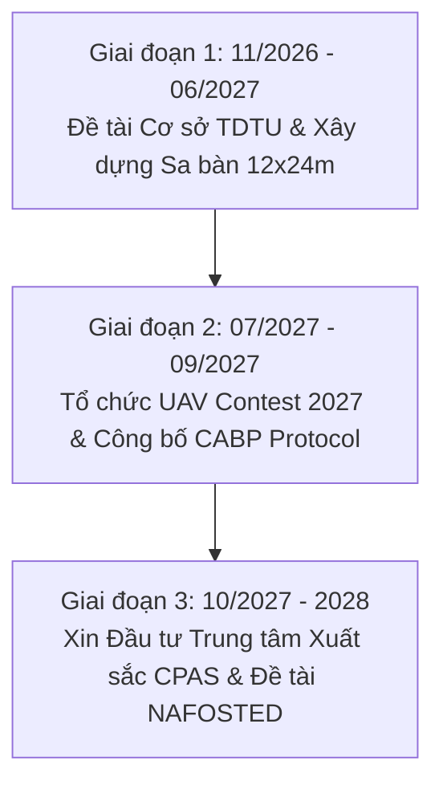

# ĐỀ ÁN CHIẾN LƯỢC: UAV CONTEST 2027 — VIÊN GẠCH ĐẦU TIÊN KHỞI TẠO CPAS LAB
> **Tên đề án**: *"Sử dụng Cuộc thi UAV Contest 2027 làm Nền tảng Đột phá Xây dựng Phòng Thí nghiệm CPAS Lab và Thu hút Đầu tư Nghiên cứu"*  
> **Đơn vị đề xuất & Thực hiện**: Đội ngũ Giảng viên, Nghiên cứu viên Khoa Điện – Điện tử & CPAS Lab, Trường Đại học Tôn Đức Thắng (TDTU)  

---

## 1. BỐI CẢNH VÀ TẦM NHÌN CHIẾN LƯỢC

### 1.1 Vai trò lịch sử của UAV Contest 2027
Năm 2027 đánh dấu **30 năm thành lập Trường Đại học Tôn Đức Thắng (24/9/1997 – 24/9/2027)**. UAV Contest 2027 không chỉ là một sự kiện thi đấu học thuật truyền thống, mà được xác định là **viên gạch nền móng đầu tiên (founding milestone)** để chính thức ra mắt và định hình vị thế quốc tế cho **Phòng thí nghiệm Hệ thống Tài sản Vật lý–Mạng (Cyber-Physical Asset Systems Laboratory — CPAS Lab)**.

### 1.2 Triết lý "Lấy Cuộc Thi Làm Trường Thử Nghiệm" (Testbed-Driven Research)
Các phòng thí nghiệm Robotics hàng đầu trên thế giới (như GRASP Lab - UPenn, Flying Machine Arena - ETH Zurich) đều phát triển vượt bậc nhờ kết hợp giữa một Phòng Lab R&D thường trực và một Sa bàn Thi đấu di động. CPAS Lab ứng dụng mô hình liên kết 2 cơ sở:
- **Phòng Lab CPAS ($300\text{ m}^2$ tại Cơ sở 98 Ngô Tất Tố)**: Được trang bị các cột trụ chịu lực tự nhiên của tòa nhà, đóng vai trò là "Tổng hành dinh" R&D thường trực 365 ngày/năm để thử nghiệm các bài toán khuất tầm nhìn (NLOS UWB), né va chạm và mô phỏng kho hàng.
- **Sân thi đấu Quốc tế (Nhà thi đấu Cơ sở chính Tân Phong, Q.7)**: Nơi tổ chức sự kiện đỉnh cao UAV Contest 2027 rộng rãi, trần cao, trang trọng.
- **Biến Bộ quy tắc cuộc thi** thành **Chuẩn Giao thức Quốc gia (CABP v0.2)** cho giao tiếp UAV/AMR tầm thấp.
- **Biến Dữ liệu trận đấu** thành **Bộ Benchmark Dataset Công bố Quốc tế (Q1 IEEE)**.

---

## 2. LỘ TRÌNH 3 GIAI ĐOẠN KHỞI TẠO CPAS LAB (2026–2028)



### Giai đoạn 1 (11/2026 – 06/2027): Xây dựng Hạ tầng Lõi & Thực nghiệm Đường cơ sở
- **Kinh phí**: 280.000.000 VNĐ (Từ Đề tài cấp Cơ sở TDTU của TS. Vũ Trí Viễn).
- **Mục tiêu**:
  - Hoàn thiện đặc tả kỹ thuật và phát hành SDK mã nguồn mở `cpas_beacon` (CABP v0.2) trên Python và C++.
  - Lắp đặt hạ tầng định vị UWB RTLS (DW1000) và hệ thống Ground Truth (4 Overhead Cameras) tại sa bàn 12×24 m.
  - Triển khai thử nghiệm 2 UAV thật chạy companion computer (Raspberry Pi 4/Jetson) kết nối Pixhawk.
  - Hoàn thành bài báo Benchmark nộp cho tạp chí SCI/SCIE (IEEE RA-L / IROS).

### Giai đoạn 2 (07/2027 – 09/2027): Tổ chức UAV Contest 2027 & Ra mắt CPAS Lab
- **Sự kiện**: Đăng cai tổ chức UAV Contest 2027 nhân dịp Kỷ niệm 30 năm TDTU.
- **Mục tiêu**:
  - Thu hút 15–20 đội thi từ các trường đại học trong nước và quốc tế (Thái Lan, Đài Loan, Hàn Quốc, Cộng hòa Séc...).
  - Yêu cầu 100% các đội thi áp dụng giao thức CABP v0.2 và định vị GPS-denied.
  - Chứng minh tính vận hành ổn định của hệ thống Ground Truth và bộ công cụ giám sát trận đấu (BOC Ground Logger).
  - Lễ cắt băng ra mắt CPAS Lab trước Ban Giám hiệu, đại diện Bộ KH&CN và các Doanh nghiệp đối tác.

### Giai đoạn 3 (10/2027 – 2028): Mở rộng Đầu tư & Đăng ký Đề tài Cấp Bộ / NAFOSTED
- **Đề án xin đầu tư**: Thuyết minh Đề án Đầu tư Phòng Thí nghiệm Trọng điểm TDTU về Cyber-Physical Systems & Autonomous Logistics (Ngân sách đề xuất: 3–5 tỷ VNĐ).
- **Đề tài NAFOSTED / Cấp Bộ**: Sử dụng số liệu thực nghiệm từ UAV Contest 2027 để thuyết minh Đề tài NAFOSTED về *"Điều khiển Phân tán An toàn cho Hệ Đa Tác thể Cyber-Physical"*.
- **Hợp tác Doanh nghiệp**: Ký kết hợp tác R&D với các doanh nghiệp logistics/nhà máy thông minh (như Viettel Logistics, THACO, Samsung Smart Factory) về bài toán điều phối hạm đội AMR/UAV.

---

## 3. THUYẾT MINH HIỆU QUẢ ĐẦU TƯ CHO NHÀ TRƯỜNG & SPONSORS

### 3.1 Giá trị mang lại cho Trường Đại học Tôn Đức Thắng (TDTU)
1. **Uy tín Học thuật Quốc tế**: TDTU trở thành trường tiên phong tại Việt Nam làm chủ giao thức giao tiếp đa tác tử (CABP) và sở hữu sa bàn benchmark định vị GPS-denied tiêu chuẩn.
2. **Sản phẩm Đào tạo Thực tế**: Đào tạo trực tiếp 5–10 học viên cao học, 15–20 sinh viên đại học làm chủ các công nghệ đón đầu (ROS 2, PX4, UWB, VIO, Physical AI).
3. **Công bố Khoa học Chất lượng Cao**: Cam kết tối thiểu 01 bài báo Q1/Q2 thuộc danh mục WoS/Scopus Nhóm A TDTU từ dữ liệu sa bàn.

### 3.2 Kế hoạch Thu hút Tài trợ Doanh nghiệp (Sponsorship Plan)

| Gói tài trợ | Mức tài trợ | Quyền lợi Doanh nghiệp |
|---|---|---|
| **Kim Cương (Diamond)** | $10.000 \text{ USD}$ (hoặc thiết bị) | Đặt tên cho Sàn thi đấu chính (Arena Title Sponsor); Đặt logo trên 100% UAV và ấn phẩm; Tiếp cận tuyển dụng trực tiếp top 10% sinh viên giỏi nhất. |
| **Vàng (Gold)** | $5.000 \text{ USD}$ | Đặt logo trên Banner, Website cuộc thi & Kỷ yếu; Tài trợ riêng cho Trạm Giao hàng AMR/Smart Warehouse. |
| **Bạc (Silver)** | $2.000 \text{ USD}$ | Đặt gian hàng triển lãm công nghệ tại Ngày hội UAV Contest 2027. |

---

## 4. DANH MỤC THIẾT BỊ ĐẦU TƯ CHO SA BÀN CPAS LAB (TẠI NHÀ THI ĐẤU)

```
Cấu trúc Hạ tầng Sa bàn CPAS Lab (12x24m)
├── Lưới Định vị UWB RTLS (8 Node Anchor DW1000 + ESP32)
├── Hệ thống Ground Truth (6 Camera Overhead Global Shutter 4K + Mini PC Workstation)
├── Trạm Nguồn & Trạm Đích Thông Minh (Tích hợp AprilTags + Động cơ Nâng/Hạ)
├── Hạm đội Robot Mẫu (03 Quadcopter F450/Pixhawk/Raspberry Pi + 02 Mobile AMR)
└── Hệ thống Máy chủ Giám sát & Router Wi-Fi Công nghiệp (Chạy BOC Logger & CABP Monitor)
```

---
*Bản đề án được phê duyệt bởi Ban Giám đốc CPAS Lab — Khởi tạo nền móng 10 năm nghiên cứu Cyber-Physical Asset Systems.*
