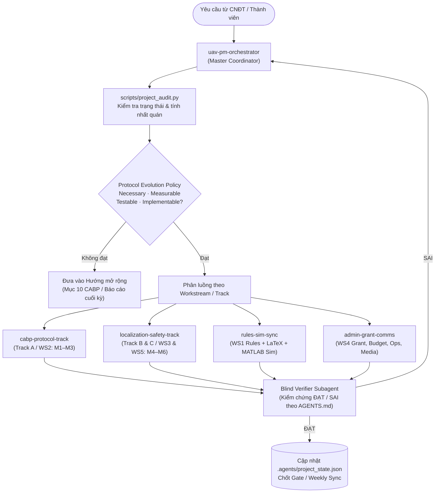

# UAV Contest 2027 & CPAS Lab — Kiến trúc Nghiên cứu Thư mục & Pipeline Điều phối Agent

**Ngày khởi tạo pipeline:** `2026-11-11`  
**Phạm vi:** Toàn bộ workspace `02_UAV_Contest_2027` (79 tệp dự án + hệ thống điều phối `.agents/` & `AGENTS.md`).  
**Mục tiêu kép:** (1) Hoàn thành **Đề tài Cơ sở TDTU** (`01/11/2026 – 30/06/2027`, CNĐT: TS. Trí Viễn Vũ, TK: TS. Trần Đức Anh Minh) và (2) Tổ chức thành công **UAV Contest 2027** (`20–21/09/2027`, kỷ niệm 30 năm thành lập TDTU).

---

## 1. Bản đồ Toàn bộ Cấu trúc Thư mục & Chuỗi Tiến hóa Tài liệu

Workspace hiện tại phản ánh 4 đợt phát triển nối tiếp nhau từ **07/2026 → 11/2026**:

```text
02_UAV_Contest_2027/
├── AGENTS.md                              # Luật vận hành luôn-bật (Always-On) cho mọi Agent
├── PROJECT_ORCHESTRATION_PIPELINE.md      # Tài liệu kiến trúc & vận hành pipeline (file này)
├── .agents/
│   ├── project_state.json                 # Trạng thái WS1–WS5, Gate 1–4, Quyết định nghẽn cổ chai
│   └── skills/
│       ├── uav-pm-orchestrator/           # Agent Điều phối Tổng (PM + scripts/project_audit.py)
│       ├── cabp-protocol-track/           # Agent Track A / WS2 (CABP v0.3 & Starter Kit)
│       ├── localization-safety-track/     # Agent Track B & C / WS3 & WS5 (UWB + AprilTag + Replay)
│       ├── rules-sim-sync/                # Agent WS1 & Digital Twin (Rules + LaTeX + MATLAB)
│       └── admin-grant-comms/             # Agent WS4 & Ops/Media (TDTU Grant, Budget, Flyers)
│
├── Rules/                                 # [CANONICAL WS1] Luật thi đấu chính thức 2027 + LaTeX VI/EN
├── CABP_Starter_Kit/                      # [CANONICAL WS2] SDK Python cabp_lite.py + mock UAV-A/B
├── MATLAB_Arena_Simulation/               # [CANONICAL SIM] Digital Twin sân 12x24m & 3 kịch bản bay
├── 26_Sep_26/                             # [CANONICAL SPEC/PLAN] CABP v0.3 + Master Plan 14 tháng
├── Ref/                                   # [REFERENCE] Luật 2024/2025/2026 (HTML, PDF, Extracted MD)
├── Video Demo/                            # [MEDIA] Multi_agent_task.mp4 (133 MB)
└── (Root Files)                           # Tài liệu chiến lược, tờ trình, dự toán, poster, bản draft cũ
```

### Phân loại Nguồn Chân lý (Canonical vs. Historical)

| Nhóm công việc | Tệp chuẩn (Canonical — Đọc/Sửa chính) | Tệp lịch sử / Tham khảo (Không dùng làm nguồn cuối) |
|---|---|---|
| **Luật thi đấu 2027 (WS1)** | `Rules/LUAT_THI_DAU_CHINH_THUC_UAV_CONTEST_2027.md`, `Rules/uav_contest_2027_rules.tex`, `Rules/uav_contest_2027_rules_en.tex` | `Luat_choi_UAV_Contest_2027.md`, `LUAT_THI_UAV_CONTEST_2027*.md/.pdf`, `Luật thi đấu.pdf`, `26_Sep_26/UAV_Contest_2027_Full_Rules_Draft_v0.2.*`, `Rules/LUAT_THI_DAU_CHINH_THUC_UAV_CONTEST_2026.md`, `Ref/*` |
| **Giao thức CABP (WS2)** | `26_Sep_26/CABP_Technical_Specification_v0.3.md` (bổ sung `mission_event`), `CABP_Starter_Kit/*` | `CPAS_Beacon_Technical_Specification_v0.1.md`, `CABP_Technical_Specification_v0.2.md`, `files.zip` |
| **Định vị & Ground Truth (WS3)** | `CPAS_Localization_Technical_Note_v0.1.md` + quyết định 6-cam Overhead AprilTag trong `26_Sep_26/CPAS_Master_Implementation_Plan_v0.1.md` | — |
| **Mô phỏng Arena (Digital Twin)** | `MATLAB_Arena_Simulation/*` (`build_uav_contest_arena.m`, `mission_*.m`, `uav_contest_2027_arena.mat`) | — |
| **Kế hoạch & Quản trị (WS4)** | `26_Sep_26/CPAS_Master_Implementation_Plan_v0.1.md` (14 tháng), `Ke_hoach_dieu_phoi_quan_ly_thuc_hien_de_tai.md` (8 tháng) | `KE_HOACH_HANH_DONG_VA_TIEN_DO_THI_DAU_2026.md` (mẫu countdown 2026 để chuyển hóa sang 2027) |
| **Chiến lược, Tờ trình & Kinh phí** | `UAV_Contest_2027_Du_Toan_Kinh_Phi.xlsx`, `TO_TRINH_BGH_UAV_CONTEST_2027_AND_CPAS_LAB.md`, `CPAS_Lab_Founding_Strategy_UAV2027.md`, `COMPARISON_UAV_2026_VS_2027.md` | — |
| **Truyền thông & Ấn phẩm** | `UAV_Contest_2027_Flyer_English.html`, `uav_contest_2027_single_page_one_pager.html`, `UAV CONTEST 2027*.pdf`, `add_poster_typography.py`, `*.png`, `*.jpg`, `Video Demo/Multi_agent_task.mp4` | `uav_contest_2026_poster.jpg` |

---

## 2. Kiến trúc Pipeline Điều phối Đa-Agent

Pipeline tách quyền sở hữu rõ ràng theo Track (tránh xung đột chỉnh sửa chéo) và áp dụng **Cổng kiểm chứng độc lập (Blind Verifier Gate)** trước khi chốt Gate 1–4:



### Quy tắc điều phối cốt lõi (Nhúng trong `AGENTS.md`)

1. **Protocol Evolution Policy (Chống phình phạm vi):** Mọi đề xuất thêm field/thiết bị/mục tiêu phải qua 4 cửa *Necessary, Measurable, Testable, Implementable*; tuân thủ danh sách *KHÔNG làm trong 24 tháng đầu*.
2. **Authority Monotonicity:** CABP chỉ phát cảnh báo/gợi ý, tuyệt đối không ghi PWM/actuator; mọi sửa đổi schema hoặc ngưỡng an toàn dùng chung (`D_MIN = 1.5 m`, `STALE_THRESHOLD = 500 ms`, `CABP_PORT = 14555`, `TIMEOUT = 3.0 s`) phải qua CNĐT/TK duyệt.
3. **Reference Frame Separation:** Tách biệt tuyệt đối `Estimated_Position` (qua CABP) với `Ground_Truth` (6 camera Overhead AprilTag của BOC, không phát qua CABP).
4. **Rules ↔ Code ↔ Sim Sync:** Đảm bảo mọi thông số sân (`12×24 m`, ACC1–4, D1–D5, Mobile Receiver `10 cm/s`) và gói tin (`31 B` periodic `5 Hz`, `16 B` mission_event) đồng nhất giữa Markdown, LaTeX, Python và MATLAB.

---

## 3. Lộ trình Workstream, Gate & Kết quả Kiểm toán Khởi tạo (`2026-11-11`)

Tính đến ngày **2026-11-11**:
- Còn **140 ngày** tới hạn công bố Luật chính thức Q1/2027 (`2027-03-31`).
- Còn **231 ngày** tới hạn kết thúc Đề tài Cơ sở TDTU (`2027-06-30`).
- Còn **313 ngày** tới ngày thi đấu UAV Contest 2027 (`2027-09-20`).

### Kết quả chạy `project_audit.py` lần đầu

- **`CABP_Starter_Kit/cabp_lite.py` Round-Trip Test:** **ĐẠT** (Periodic `31 B`, Mission Event `16 B`, port `14555`, magic `0xCB`).
- **4 cảnh báo lệch đồng bộ (`WARN`) được phát hiện tự động cần xử lý ở `DEC-05`:**
  1. `TO_TRINH_BGH_UAV_CONTEST_2027_AND_CPAS_LAB.md` (và `COMPARISON_UAV_2026_VS_2027.md`) đề cập **2 sân song song 25×30 m** và **MTOW 3.5 kg / gói 100 g**, trong khi Luật Chính thức (`Rules/LUAT_THI_DAU_CHINH_THUC_UAV_CONTEST_2027.md`) & `MATLAB_Arena_Simulation/` đang dùng **12×24 m**, **MTOW ≤ 5.0 kg**, khối **300 g** + **bóng tennis**.
  2. `26_Sep_26/CABP_Technical_Specification_v0.3.md` dòng 266 vẫn ghi ví dụ `D_MIN (VD: 1.0 m)`, trong khi Luật Chính thức & MATLAB đã chốt `D_MIN >= 1.5 m`.
  3. `CABP_Starter_Kit/cabp_lite.py` dòng 46 docstring ghi `(29 bytes)` dù struct `>BBHIQBBfffB` thực tế dài **31 bytes** (khớp dòng 70 và Luật Chính thức).
  4. Mục lục của `Rules/LUAT_THI_DAU_CHINH_THUC_UAV_CONTEST_2027.md` đánh số CABP là mục `11.` trong khi tiêu đề thân bài là `## XII.`, và `CABP_Starter_Kit/README.md` vẫn trích dẫn `Mục XIII` (từ bản Draft v0.2).

### Ma trận Gate Kiểm soát

| Gate | Milestone | Khung thời gian | Trạng thái | Điều kiện qua cổng |
|---|---|---|---|---|
| **Gate 1** | M1, M2 | 12/2026 – 01/2027 | `IN_PROGRESS` | `cpas_beacon` chạy đủ 2 biến thể (Debug JSON + Production Binary) có test coverage; báo cáo latency/loss bench-test 2 board có số liệu thực đo |
| **Gate 2** | M3 | 02/2027 | `NOT_STARTED` | Demo ngắt kết nối giả lập kích hoạt safety mode đúng `STALE_THRESHOLD` (`500 ms`); đo được clock drift thực nghiệm |
| **Gate 3** | M4, M5 | 04/2027 – 05/2027 | `NOT_STARTED` | Demo mô phỏng + video bay thật trên 2 UAV; tách biệt đủ log CABP thô & log Ground Truth |
| **Gate 4** | M6 | 06/2027 | `NOT_STARTED` | Báo cáo benchmark định vị sơ bộ hoàn chỉnh; báo cáo tổng kết Đề tài Cơ sở sẵn sàng nộp Phòng QLKH TDTU |

---

## 4. Hướng dẫn Sử dụng Pipeline Điều phối

### Cách 1: Kiểm tra sức khỏe dự án tức thời (CLI)
```bash
python .agents/skills/uav-pm-orchestrator/scripts/project_audit.py
```
Thêm `--json` để xuất dữ liệu có cấu trúc cho agent/dashboard khác tiêu thụ.

### Cách 2: Điều phối Đa-Agent trong Antigravity
- **Họp Sync tuần / Rà soát Gate:** Yêu cầu agent *"Đóng vai uav-pm-orchestrator, chạy project_audit.py và lập báo cáo tuần / rà soát Gate 1"*.
- **Chạy tác vụ song song nhiều Track (dùng `/teamwork` hoặc `swarm` / `invoke_subagent`):**
  1. Gán `cabp-protocol-track` xử lý docstring `cabp_lite.py`, hoàn thiện unit test & C++ port (`M1–M2`).
  2. Gán `rules-sim-sync` đồng bộ mục lục `Rules/LUAT_THI_DAU_CHINH_THUC_UAV_CONTEST_2027.md`, LaTeX VI/EN và đối chiếu `TO_TRINH_BGH_*`.
  3. Gán `localization-safety-track` chuẩn hóa checklist khảo sát trần Nhà thi đấu Tân Phong (`DEC-02`) và cấu trúc thư mục log tách biệt cho WS3/WS5.
  4. Gán một agent `research` độc lập làm **Blind Verifier** kiểm tra `ĐẠT / SAI` toàn bộ thay đổi dựa trên hợp đồng trong `AGENTS.md`.

### 5 Việc Ưu tiên Ngay Tuần Này (Từ `2026-11-11`)
1. **[CRITICAL — DEC-01]** Khởi động báo giá & đặt mua UWB Anchors, 6 camera Global Shutter và companion computer (tránh nút thắt lead-time 16–24 tuần).
2. **[HIGH — DEC-02]** Khảo sát độ cao trần thực tế Nhà thi đấu Tân Phong để chốt vị trí 6 camera Ground Truth và quyết định giải ngân Mục A4.7 (10 triệu VNĐ).
3. **[HIGH — DEC-03]** Họp kickoff xác nhận chính thức Track Lead A/B/C và 2 SV hỗ trợ kèm lịch học kỳ.
4. **[MEDIUM — DEC-04]** Xác nhận lịch nộp báo cáo giữa kỳ/cuối kỳ với Phòng QLKH TDTU.
5. **[MEDIUM — DEC-05]** Giao pipeline agent xử lý 4 cảnh báo đồng bộ tài liệu/code vừa phát hiện ở `project_audit.py`.
